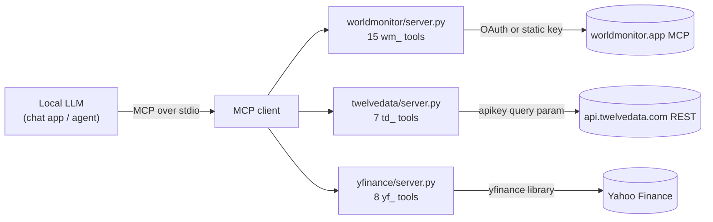

# local-llm-mcp-servers

Three small MCP (Model Context Protocol) servers that give a locally hosted LLM live tools for world events, market prices and company fundamentals.

## Why it exists

A local model knows nothing after its training cutoff and cannot look anything up. Public data services do publish their own MCP servers or APIs, but they are built for large cloud models: one hosted server here lists 90 tools and about 100k tokens of schema, which at local prefill speeds costs minutes per new chat and most of the context window. Others need an interactive OAuth login that a simple HTTP bridge cannot refresh.

These servers are thin, hand-shaped wrappers. Each exposes a short list of tools with plain signatures, small defaults and capped replies, so a mid-sized local model can pick the right tool and read the answer without drowning in it.

## How it fits together



| Server | What it answers | Tools | Key |
|---|---|---|---|
| [`worldmonitor/`](worldmonitor/) | News, conflicts, disasters, markets, prediction markets, military posture, shipping chokepoints, energy, cyber, outbreaks, aviation | 15 (`wm_*`) | Browser login (free account) or `WORLDMONITOR_API_KEY` |
| [`twelvedata/`](twelvedata/) | Live and historical prices for stocks, ETFs, forex and crypto; technical indicators; ranked comparisons | 7 (`td_*`) | `TWELVEDATA_API_KEY` (free plan works) |
| [`yfinance/`](yfinance/) | Company profile, valuation stats, dividends, earnings, financial statements, price history, analyst ratings, news | 8 (`yf_*`) | None |

Twelve Data and yfinance are companions: Twelve Data's free plan serves prices and indicators but refuses profile, statistics, earnings and dividends (HTTP 403), and yfinance fills exactly that gap.

## Features

- MCP over stdio; each server is one Python file with an inline PEP 723 dependency header, runnable with `uv run`.
- Every reply is capped at 12,000 characters, and truncation is announced in the reply rather than silent.
- Errors come back as plain-English `ERROR ...` strings the model can read and relay, never as stack traces.
- Missing credentials return a setup message instead of failing or hanging.
- Read-only by design: no trading or order tools anywhere.
- World Monitor: OAuth client with dynamic registration, PKCE and silent token refresh, which never opens a browser from a tool call; `--login`, `--status` and a quota-free `--selftest`.
- Twelve Data: multi-symbol calls are one comma-separated request; `td_compare` computes percent changes server-side; 429 responses are rewritten to explain the rate limit.
- yfinance: curated field subsets instead of the 187-key `.info` dump; long price histories returned as CSV and resampled (daily to weekly to monthly to quarterly) instead of cut off.

## How it works: design decisions

**Shape tools for the model that will read them.** The audience is a local model in the tens of billions of parameters, not a frontier cloud model. So each tool list is short, each docstring says when to use the tool, defaults are small (`limit=10`), and tools that can only fail on the free plan are left out entirely, because a dead tool is noise the model has to read past.

**Do arithmetic in code, not in the model.** `td_compare` returns ranked percent changes rather than raw bars, and yfinance computes summary stats from the full series before resampling. Arithmetic over long number series is where small models go wrong, and a wrong number reads as a real one.

**Make empty data loud.** A bad ticker in yfinance does not raise; it returns a dict of `None`s or an empty frame. The server checks for that and returns an explicit error, because a model handed nulls tends to report them as data. NaN becomes `null`, never the string `"nan"`.

**Measure before raising a cap.** The yfinance history tool first returned JSON objects, which hit the 12,000-character cap after about 81 daily bars. Switching to CSV (about 48 characters a bar instead of about 149) and resampling past `max_bars` lets a five-year request return the whole window.

**Wrap, do not proxy.** World Monitor's hosted MCP is wrapped rather than exposed directly (schema size, and OAuth that a static-header bridge cannot do). Twelve Data's hosted MCP is skipped for its REST API for the same OAuth reason. Yahoo's endpoints need a cookie and crumb handshake, so the yfinance library is wrapped instead of raw HTTP.

Each subfolder's README has that server's own design notes.

## Quick start

Requirements: Python 3.12+ (World Monitor's header requires it) and [uv](https://docs.astral.sh/uv/). Network access to the upstream services.

```bash
git clone <this repo> && cd local-llm-mcp-servers
cp .env.example .env        # fill in TWELVEDATA_API_KEY; export the values in your shell or client config

# Each server runs over stdio; your MCP client starts it. To check one starts:
uv run yfinance/server.py

# World Monitor, once, to sign in with a (free) World Monitor account in the browser:
uv run worldmonitor/server.py --login
uv run worldmonitor/server.py --status
```

Without uv: `pip install -r requirements.txt`, then `python <server>/server.py`.

### Register with an MCP client

Most desktop MCP clients accept an `mcpServers` JSON block. Use absolute paths:

```json
{
  "mcpServers": {
    "worldmonitor": { "command": "uv", "args": ["run", "/path/to/local-llm-mcp-servers/worldmonitor/server.py"] },
    "twelvedata":   { "command": "uv", "args": ["run", "/path/to/local-llm-mcp-servers/twelvedata/server.py"],
                      "env": { "TWELVEDATA_API_KEY": "your-key" } },
    "yfinance":     { "command": "uv", "args": ["run", "/path/to/local-llm-mcp-servers/yfinance/server.py"] }
  }
}
```

Claude Code: `claude mcp add yfinance -- uv run /path/to/local-llm-mcp-servers/yfinance/server.py`.

Chat front ends that only speak OpenAPI (for example Open WebUI) can reach these through an MCP-to-OpenAPI bridge such as [mcpo](https://github.com/open-webui/mcpo); that is how they were run originally.

## Project structure

```
local-llm-mcp-servers/
├── worldmonitor/   server.py (15 tools, OAuth client, CLI) + README with design notes
├── twelvedata/     server.py (7 tools over the REST API) + README
├── yfinance/       server.py (8 tools over the yfinance library) + README
├── .env.example    the environment variables the servers read
└── requirements.txt  for a pip setup; uv users can ignore it
```

## Third-party services and limits

These figures come from the original project notes, with the date they were checked. Plans change; trust the service over this table.

- **World Monitor** (worldmonitor.app; its upstream code is AGPL-3.0, and none of it is included here). Probed 2026-10-09: a free account allows 5 MCP calls per UTC day and only the cache-read tools; Pro allows 50 a day and all tools. `wm_world_brief`, `wm_country_risk` and `wm_hotspots` are Pro only and return the upstream's own refusal on a free account. `wm_allowance` is quota-free. Static `wm_` keys exist only on paid API plans or a self-hosted stack.
- **Twelve Data.** The free "Basic" plan is credit-metered per minute; exact limits were not verified, so `td_api_usage` reports the real remaining quota. `/profile`, `/statistics`, `/earnings` and `/dividends` return 403 on the free plan and are not exposed.
- **Yahoo Finance via yfinance.** There is no key or quota, but yfinance uses Yahoo's private endpoints rather than a contracted API, so Yahoo breaks it from time to time and fixes arrive as patch releases. That is why the pin is `yfinance>=1.7,<2`. Yahoo throttles clients that hammer it.

## Status and roadmap

- **yfinance: working.** Verified with live data on 2026-09-18 against yfinance 1.7.0, mounted in a local chat front end and in real use.
- **worldmonitor: built, live data not yet exercised.** Verified in-process with real fastmcp (15 tools listed; the no-login and expired-login paths return the setup message), through an mcpo bridge, and with `--selftest` against the live endpoint. No account login had been done, so reply sizes on real data are unverified.
- **twelvedata: built, not yet run with a key.** The free-tier behavior was probed with keyless requests on 2026-09-18; until a key is set every tool returns the setup message.

No automated test suite is included. Possible next steps: tests with recorded responses, and paid-plan Twelve Data tools if a plan upgrade ever makes them useful.

## How this was built

Ryan Wisth built these by directing AI coding agents (Claude Code). He set the goals and constraints (local-model token budget, read-only, no trading tools), wrote the acceptance checks, and verified the results against the live services and his local model stack. The agents wrote most of the code to that specification; the design notes record the measurements and bugs that shaped it.

## License

MIT, see [LICENSE](LICENSE). Not affiliated with or endorsed by World Monitor, Twelve Data, Yahoo, or the yfinance project. All trademarks belong to their owners. Use of each upstream service is subject to that service's own terms.
